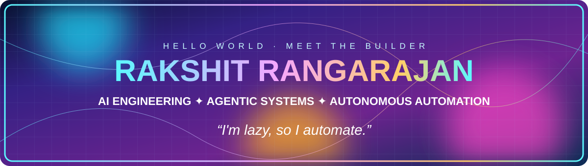
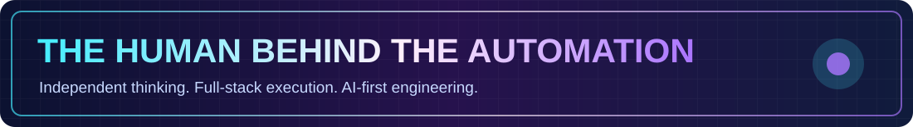
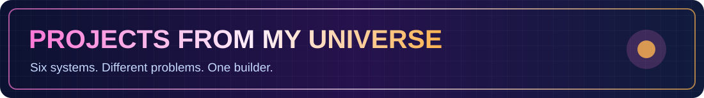
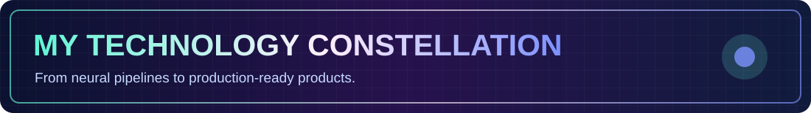
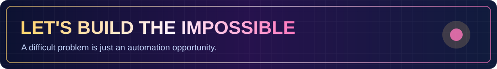

### 🚀 AI Solutions Engineer • Agentic AI Builder • Automation Architect

**I don't just integrate AI into products. I identify problems, architect solutions, and build the systems myself.**

---

⚡ AI architect mode: ON · Explore the systems behind the holograms below

## 🌌 The builder behind the systems

I'm **Rakshit Rangarajan**, a software engineer with a **Master's in Artificial Intelligence from Cardiff University**. My specialty is transforming manual, repetitive, or fragmented workflows into useful AI-driven products.

I work across **AI architecture, multi-agent orchestration, RAG, backend engineering, polished frontends, and release automation**. I enjoy owning the whole problem — from the first sketch to the deployed application.

> ⚡ **My philosophy:** *I'm lazy, so I automate.* The best engineering removes work that never needed to be manual.

## 🪐 Explore my AI universe

| 🌟 Project | What I'm building | Domain |
|:---|:---|:---|
| 🧠 **Pantheon** | A connected universe of specialized AI agents sharing knowledge and coordinating tasks | Multi-agent systems |
| ⚡ **AERO** | Autonomous enterprise development, release, and operations workflows | DevOps automation |
| 🎓 **NeuralForge** | An immersive engineering mentorship and learning platform | AI + EdTech |
| 📚 **Mnemosyne** | A source-grounded personal knowledge platform | RAG + knowledge |
| 🌀 **OUROBOROS** | An experiment in continually evolving software | Autonomous systems |
| 👁️ **IRIS** | An expressive desktop-and-mobile AI assistant | Human–AI interaction |

## 🧬 What I bring to the table

- **AI systems:** LLM integration, RAG pipelines, vector search, agentic workflows, orchestration and grounded responses.
- **End-to-end engineering:** Python, C#, ASP.NET Core, Angular, TypeScript, REST APIs and distributed systems.
- **Production thinking:** PostgreSQL, pgvector, MongoDB, Redis, Podman, Linux, CI/CD and automated testing.
- **Ownership:** I proactively discover opportunities for automation and build working solutions independently.

## 🛠️ Technology constellation

## 📊 GitHub signal

---

### 💡 Have a difficult problem that needs an AI-powered solution?

**Let's turn it into a working product.**

[🌐 Portfolio](https://rakshitr.co.in) · [💼 LinkedIn](https://linkedin.com/in/rakshit-rangarajan-2084b2211/) · [✉️ Email](mailto:rakshitr2000@gmail.com)

